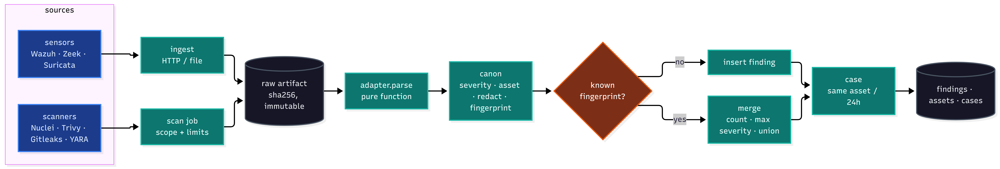
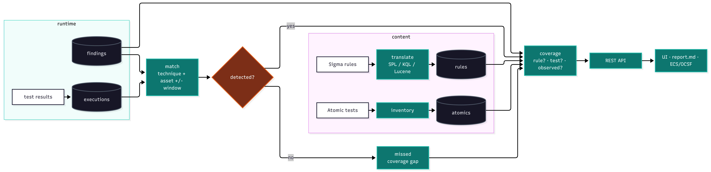
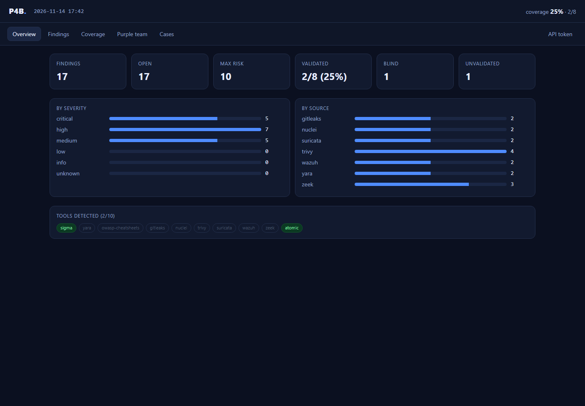

# Pr0j3ct_N4m3_b1g — P4B

**A detection engineering workbench for ten open-source security tools.**

P4B normalizes telemetry from Wazuh, Zeek and Suricata, runs Nuclei / Trivy /
Gitleaks / YARA scans, manages Sigma and YARA content as code, and uses Atomic Red
Team to *prove* that detections actually fire.

The product is one loop:

```
telemetry + scans → findings → ATT&CK → coverage → tests → fix rules → repeat
```

The question it answers: **which ATT&CK techniques am I blind to, and what is the
evidence?**





Editable diagrams live in [docs/FLOWS.md](docs/FLOWS.md).

> Repository name is `Pr0j3ct_N4m3_b1g`; the package, CLI and images are `p4b`
> (see [ADR-010](docs/ADR.md)).

## Status

| Milestone | Content | State |
|---|---|---|
| **M0** | foundation: config, schema, migrations, CLI, tests | **done** |
| **M1** | closed loop: Wazuh + Suricata + Zeek + Sigma + Atomic → coverage | **done** |
| **M2** | scanners in the loop: Nuclei / Trivy / Gitleaks / YARA | **done** |
| **M3** | product: UI, auth, cases, export, containers | **done** |
| **M4** | real lab: Ubuntu 26.04 VMs, Wazuh + agent, Suricata, Zeek | **done** |

The design is approved and lives in [docs/ARCHITECTURE.md](docs/ARCHITECTURE.md);
decisions and their trade-offs are in [docs/ADR.md](docs/ADR.md).

## The UI



Demo dataset: 17 findings, 2/8 techniques validated (25%), one blind and one
unvalidated technique. The same UI over the lab database — 22 findings from Wazuh,
Suricata and Zeek — is [assets/ui-lab.png](assets/ui-lab.png).

## Real lab

Three Ubuntu 26.04 VMs on VMware (`p4b`, `sensor`, `siem`), all three sources run
for real:

| Source | Version | Result |
|---|---|---|
| Wazuh manager + agent | 4.14.10, agent id 001 | rule 100100 alert from agent `sensor` |
| Suricata | 8.0.3, live on `ens33` | ET Open alerts on real cross-host HTTP |
| Zeek | 9.0.1 | conn/http/notice logs |

`p4b` ends with **22 findings / 13 assets**, re-ingest is idempotent, and
`deploy/lab/verify-lab.sh` reports **8 pass / 0 fail / 0 skip**.
Build notes and traps: [docs/LAB.md](docs/LAB.md).

## Verification

Repeatability is checked, not assumed. The committed artifacts in
[`artifacts/soak/`](artifacts/soak/) were produced by the scripts beside them:

| Artifact | Evidence |
|---|---|
| [`soak-50.md`](artifacts/soak/soak-50.md) | 50 consecutive full loops (fresh DB → demo → re-ingest → re-validate → ECS + OCSF → 9 API reads): **0 failures, 0 drift** |
| [`pytest-50.md`](artifacts/soak/pytest-50.md) | the 292-test suite run 50 times: **292 passed on every run** |

```bash
python deploy/soak/soak.py --iterations 50
python deploy/soak/tests.py --iterations 50
```

The raw ECS export hash differs between runs because Gitleaks findings carry no
timestamp and are stamped at ingestion; the artifact reports both the stable hash
(identical) and the raw-hash variance. The `soak` GitHub workflow runs the same
scripts on demand and uploads the artifacts.

## Quickstart

```bash
python -m pip install -e ".[dev]"
p4b init          # data dir, schema (Alembic), default tenant
p4b doctor        # detect the ten tools, record versions
p4b demo          # full loop on bundled fixtures -> data/reports/report.md
p4b serve         # UI at / and read-only API + OpenAPI docs at /docs
p4b export --format ocsf   # NDJSON for another SIEM (ecs or ocsf)
p4b worker --once          # run due scheduled scans (p4b job add ...)
p4b config        # show effective settings
pytest -q
```

`p4b doctor` reports which binaries are present. Missing tools are expected on a
laptop — install them, or use the `p4b-scanner` image described below.

## Run it in Docker

```bash
docker compose -f deploy/docker-compose.yml up --build
# UI + API at http://localhost:8080   (OpenAPI docs at /docs)

# demo inside the container (the data volume survives restarts)
docker compose -f deploy/docker-compose.yml run --rm p4b demo --reset

# one-shot scanner: nuclei/trivy/gitleaks/yara are baked into this image
docker compose -f deploy/docker-compose.yml run --rm scanners scan \
  --tool yara --rules /data/rules/lab.yar --target /data
```

Two build targets share one Dockerfile: `app` (API + UI, no offensive tooling) and
`scanner` (adds the four binaries, pinned by version). Compose keeps `scanners`
behind a profile so `up` never starts it.

## What is integrated

| Layer | Tools | How P4B consumes them |
|---|---|---|
| Active scan | Nuclei, Trivy, Gitleaks | subprocess, native JSON output |
| Detection content | Sigma, YARA | rule inventory, translation, indexing |
| Telemetry | Wazuh, Zeek, Suricata | log/HTTP ingest, never embedded |
| Validation | Atomic Red Team | test inventory + execution results |
| Knowledge | OWASP CheatSheetSeries | remediation links (not copied text) |

Nothing is linked in-process: Wazuh and Suricata are GPLv2, Sigma rules are DRL,
cheatsheets are CC BY-SA. Adapters talk to tools through processes, files and HTTP
(see [ADR-002](docs/ADR.md)).

## Layout

```
src/p4b/
  domain/     severity, risk, fingerprint, dataclasses
  canon/      asset normalization (pure functions)
  store/      SQLAlchemy Core tables, repositories, migrations bridge
  tooling.py  the ten tools: availability, version, license
  cli.py      p4b init | doctor | config | version
migrations/   Alembic environment and revisions
tests/        unit tests (in-memory SQLite)
docs/         architecture + ADRs + lab guide
```

## Requirements

Python 3.10+, SQLite (bundled). Postgres is supported by changing `db_url`; the
schema avoids SQLite-only constructs.

## License

Application code: MIT. Vendored rule repositories keep their own licenses
(Sigma DRL 1.1, YARA BSD-3-Clause, Atomic Apache-2.0, OWASP CC BY-SA 4.0).
