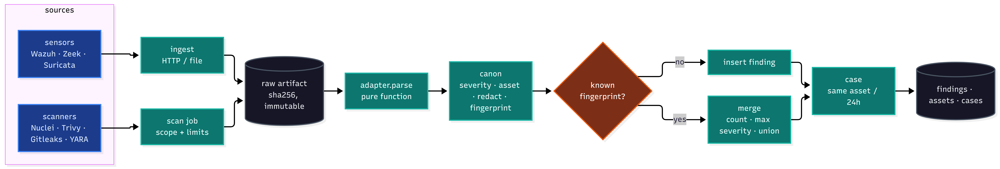
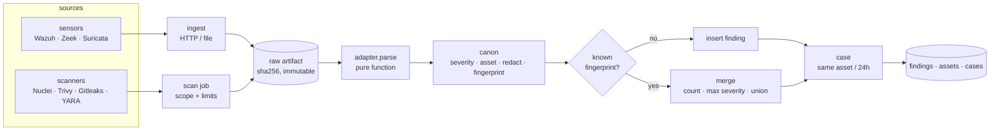
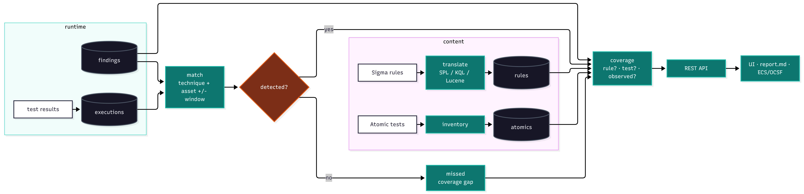
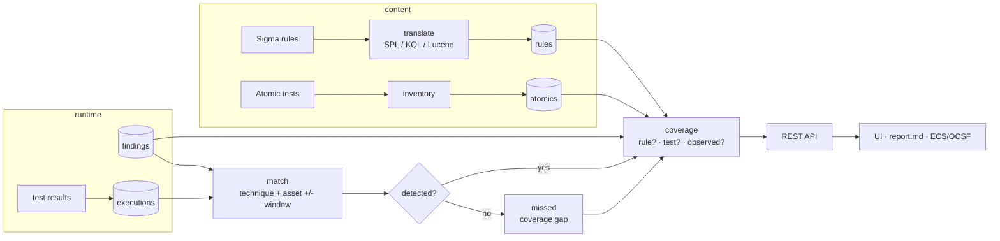

# Data flows

Two diagrams explain the whole system. Rendered copies live in `assets/`; the sources
below stay in the repo so they can be edited.

## 1. Ingest and normalization

## 2. Detection loop

## Reading the coverage matrix

| rule | test | observed | status |
|---|---|---|---|
| yes | yes | yes | `validated` — proven |
| yes | yes | no | `unvalidated` — test did not fire |
| yes | no | yes | `detected` — works, no regression test |
| yes | no | no | `rule-only` — never exercised |
| no | yes | no | `test-only` — blind |
| no | yes | yes | `no-rule` — caught by luck |
| no | no | no | `gap` — nothing |

`coverage_score = validated / total`. Nothing else counts.
